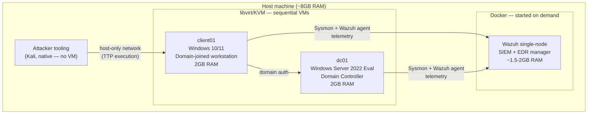

# Architecture

## Design constraints

This lab is deliberately scoped down from a "full" adversary range
(domain controller + several clients + dedicated C2 VM + ELK) to fit a
single workstation with **~8 GB RAM and 2 vCPUs**. Two cuts were made
on purpose:

1. **One client instead of 2–3.** A single domain-joined workstation is
   enough to demonstrate initial access, lateral movement, and
   escalation TTPs. Add more `client0N` blocks to `vagrant/Vagrantfile`
   if you move to bigger hardware.
2. **No dedicated attacker VM.** The attacking tooling runs from the
   host itself (e.g. a Kali install) rather than inside a VM, which
   removes an entire VM's RAM/CPU footprint. The host talks to the lab
   over a libvirt/VirtualBox host-only network.
3. **Wazuh instead of a full ELK/Splunk deployment**, run on demand via
   Docker rather than kept running 24/7. It's lighter (~1.5–2 GB) and
   doubles as an EDR agent on the Windows hosts, which gives richer
   telemetry than log shipping alone.

Because of the RAM budget, **VMs are brought up sequentially**: start
only what the current phase needs (e.g. `dc01` + `client01` to execute
a TTP), then stop the client and start the detection stack to review
and capture the resulting alerts, rather than running everything at
once.

## Diagram

## Network layout

| Network | Purpose |
|---|---|
| `lab-internal` (host-only) | DC ↔ client traffic (AD auth, SMB, RPC) |
| `lab-attacker` (host-only, bridged to host) | Attacker host ↔ client, simulates initial access / C2 |
| Docker bridge | Wazuh manager ↔ agents, only reachable from `lab-internal` when stack is up |

## Scaling up

If you move this to a bigger host or a VPS with 16GB+ RAM:

- Bump `vb.memory` / `libvirt.memory` in `vagrant/Vagrantfile` to 4GB per VM.
- Add `client02`, `client03` blocks for lateral-movement scenarios across
  multiple hosts.
- Replace the host-based attacker with a dedicated `c2-linux` VM if you
  want full network isolation between attacker and host OS.
- Swap Wazuh single-node for a proper Elastic/Splunk cluster if the
  detection content needs to show off SPL/KQL at scale rather than
  Wazuh's rule engine.

## draw.io export

A `.drawio` version of this diagram (for editing visually) is not
generated automatically here — import the Mermaid source above into
[draw.io](https://app.diagrams.net) via **Extras → Edit Diagram → paste
as Mermaid**, or regenerate it with the `mermaid` CLI and trace over it.
